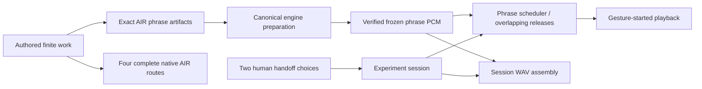

# A borrowed beat · 借来的半拍

A finite phrase-handoff study: piano starts with a measured phrase, marimba
answers with a displaced accent, and nylon guitar leaves room beneath them.
Eight authored two-bar phrases at 96 BPM make a complete default performance.
Two decisions change who takes the next phrase and what returns at the end.

```bash
npm ci
npm run handoff
# http://127.0.0.1:4391
npm run test:handoff
```

`handoff:prepare` selectively prepares the existing exact acoustic candidates,
then renders each authored phrase with the canonical audio engine into the
ignored `.audio/` directory. The first preparation may acquire exact sound
assets from their documented upstreams; later preparation reuses verified local
content. There is no model call, account, upload or new sample identity.
`build:handoff` prepares those sounds and produces a self-contained relative-path
static directory. Serve `apps/handoff-study/dist` over localhost or HTTPS;
`file://` is unsupported. The ordinary workspace build compiles the interface;
use `build:handoff` to produce its complete prepared listening package.

## Listen, hand over, and return

- **聆听 / 暂停** starts or holds the performance. Loading can be cancelled.
  Opening the page, a saved experiment, or a comparison never starts audio.
- **中间那句** enters at beat 16 (bar 5); **最后的回来** enters at beat 40
  (bar 11). Choose piano or marimba before that boundary. A pending choice is
  audible only when the next phrase begins; the current phrase keeps speaking.
- The scheduler locks a choice up to 160 ms before entry. A locked button means
  the phrase has already been committed. Go back to the beginning to change it.
- Both alternatives have authored foreground, accompaniment and later
  consequences. There is no hidden composer or random arrangement.
- Phrase buttons and the time slider seek. A paused seek stays paused; a playing
  seek reconstructs all still-decaying phrases together at the target position.
- **回到开头** retains the selected handoffs. **原演奏 / 我的接句** compares
  complete routes while preserving edits; changing comparison stops playback.
  **恢复原来的接句** clears the two choices without starting sound.
- Space plays/pauses outside controls. Buttons use normal keyboard activation.
  Leaving the page pauses playback. The monitor volume is local listening state.

The bounded experimental stage shows actual note facts for the current phrase,
its two melodic voices, and eight phrase landmarks. It is this study's interface,
not another production AIR Canvas or a replacement for the Selen composers.

## Save and export

**保存这一遍** downloads `handoff-study-session@0`. The file carries the full
`handoff-study-work@0`, complete canonical route and phrase artifacts, exact
prepared-audio byte/digest references, the shared mixer level, and each selected
handoff's requested/effective beat. It stores the latest choice at each of the
two gates, not a pointer trace or a recording of every button press. Saving the
original comparison saves its original route; your edited route stays in the app.

Opening a file checks the entire work and audio reference closure against this
build before applying it. Another version remains a portable source document but
cannot silently acquire this build's sounds. Unknown fields, versions, duplicate
gates and impossible timing fail; the existing work remains intact. Files are
bounded to 4 MiB. LocalStorage is origin-specific; use a saved file when moving
ports or browsers. Playback position and comparison mode are not saved.

**带走 WAV** snapshots the selected complete route, including overlapping tails,
at the time of the export click. It uses the same frozen PCM phrases and mixer
level as playback and the canonical WAV encoder. It does not start playback;
monitor volume does not enter the output. A clipped/invalid result fails rather
than being silently normalized. The assembled experiment WAV has no native
Refrain RenderReceipt: it is a frozen realization of this phrase experiment.

**带走这条路线的原生 air** exports the separately authored complete Artifact@3.
It uses canonical AIR compilation, exact sampled binding and ordinary Player
playback. Whole-piece RR/DSP history can differ from independently rendered,
overlapping phrase projections; it is an inspectable native performance of the
same authored route, not a byte-identity claim about the experiment WAV.

## Source and execution



The work owns allowed material and routes; the session owns this person's two
choices. Prepared audio is a projection. Complete native AIR routes remain
inspectable beside the experimental realization, with their own exact authority.

## Ownership and evidence

`score.ts` owns authored material and the four finite routes;
`prepare-handoff-study.ts` owns exact canonical preparation and sound notices.
`model.ts` owns versioned session/choice closure; `engine.ts` owns gesture-only
playback, finite scheduling, cancellation and transport; `wav.ts` assembles
frozen phrases and delegates encoding to the existing audio package. The app
keeps UI/persistence outside musical source. Prepared WAVs are projections, not
canonical music or tracked repository assets.

Run `test:handoff` for typecheck, focused model/scheduler/audio/source tests and a
prepared build. Browser verification additionally covers actual nonzero sound,
no pre-gesture WAV request, both handoffs, unchanged prefix, pause/resume/seek/
restart/end, comparison preservation, save/reopen/invalid input, full WAV export,
keyboard and desktop/mobile overflow. Mechanical validity and browser playback
do not establish human listening, visual acceptance, physical-device behavior,
MCP integration or deployment. Existing project licenses and asset-level
upstream notices apply.
